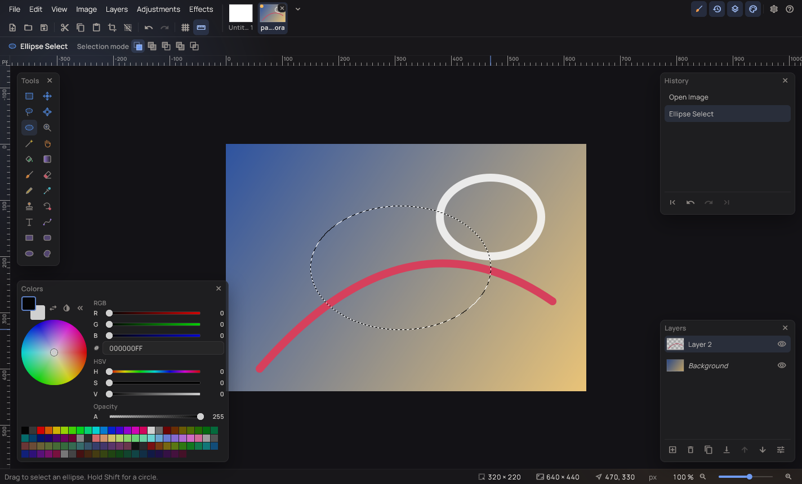
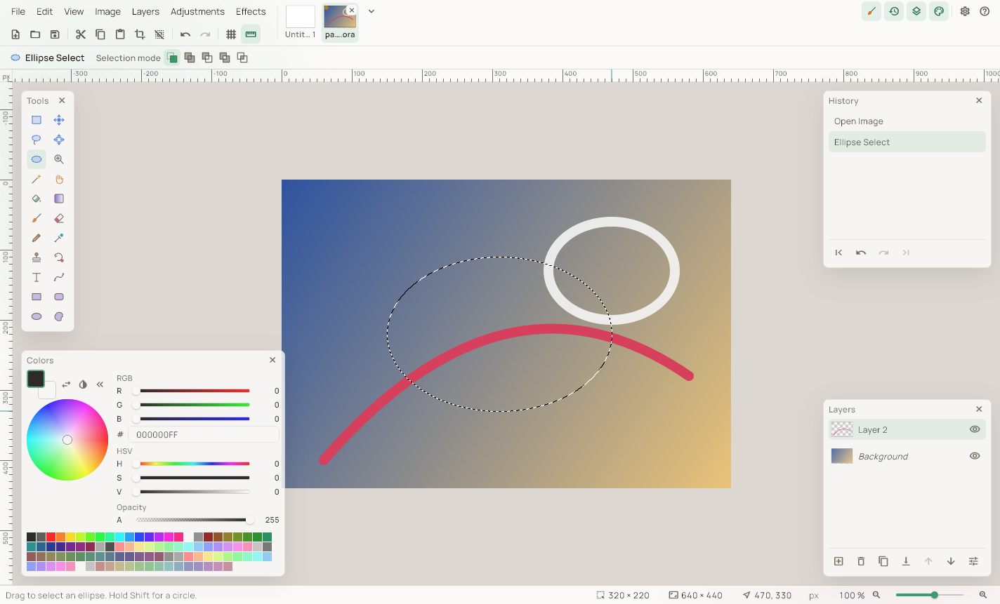
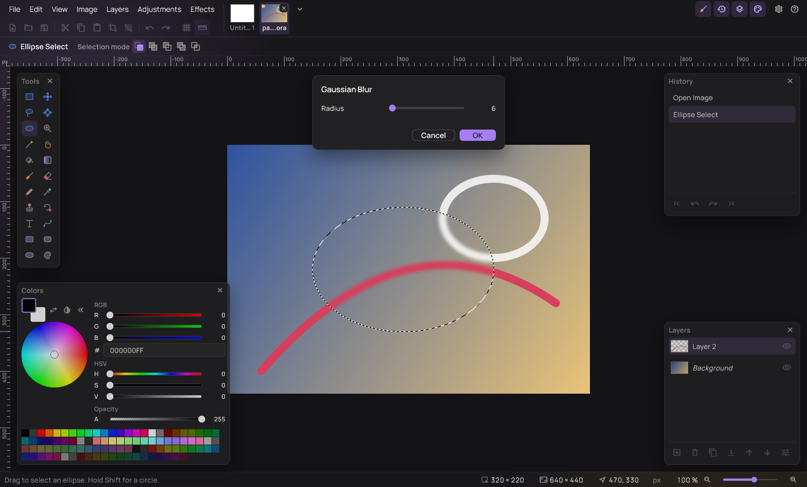

# Paintbox

**English** · [Українська](README.uk.md)

Paintbox is a free image editor for everyday drawing and photo touch-ups.
It works the way Paint.NET 3.x does, with layers, the familiar tools and
the same keyboard shortcuts, and it is built to run on Windows, Linux and
macOS.



## Features

- **Layers**: add, duplicate, merge, reorder by dragging, hide, and set
  opacity and one of 14 blend modes for each layer.
- **Selection tools**: rectangle, ellipse, lasso and magic wand, with
  replace, add, subtract, intersect and invert modes; move the selection
  or the selected pixels, rotate and scale them.
- **Drawing tools**: paintbrush, pencil, eraser, paint bucket, gradient
  (five kinds), clone stamp, recolor, color picker, text, lines and
  curves with arrowheads and dash styles, rectangles, rounded
  rectangles, ellipses and freeform shapes.
- **Adjustments**: auto-level, black and white, brightness and contrast,
  curves, hue and saturation, invert colors, levels, posterize and
  sepia, each with a live preview.
- **31 effects**: artistic (ink sketch, oil painting, pencil sketch),
  blurs (Gaussian, motion, radial, surface, unfocus, zoom, fragment),
  distortions (bulge, dents, frosted glass, pixelate, polar inversion,
  tile reflection, twist), noise, photo (glow, red-eye removal, sharpen,
  soften portrait), rendering (clouds, Julia and Mandelbrot fractals) and
  stylize (edge detect, emboss, outline, relief).
- **Files**: OpenRaster (`.ora`) keeps layers; PNG, JPEG, BMP, TGA and
  WebP are also supported. Images open in tabs with thumbnails, and you
  can drop files onto the window.
- **Familiar keys**: tools by letter, `[` and `]` for the brush width,
  `X` to swap colors, Space to pan, Ctrl+wheel to zoom, F5–F8 for the
  windows, and the Paint.NET menu shortcuts.
- **Your look and language**: dark or light theme, six accent colors or
  your own, and 25 interface languages.





## Download

Ready-made builds are published on the [Releases](../../releases) page.

| Platform | Package | Status |
|---|---|---|
| Windows 10 and 11 (x64) | Portable zip, MSIX, installer | Ready |
| Linux (x64) | AppImage | In progress |
| macOS (Apple silicon and Intel) | Signed app in a dmg | In progress |

## Build from source

You need Flutter 3.47 and stable Rust. The Rust core is compiled as part
of the Flutter build:

```
cd app
flutter pub get
flutter run -d windows
```

[docs/building.md](docs/building.md) covers the checks, screenshots and
packaging for each platform, and [CONTRIBUTING.md](CONTRIBUTING.md)
explains how the code is organized.

## License

Paintbox is free software under the
[GNU General Public License, version 3 or later](LICENSE). You may use,
study, share and change it; if you distribute a changed version, you
must publish its source code under the same license. The licenses of
the ported code, the font and the libraries are listed in
[NOTICE.md](NOTICE.md) and [docs/third-party.md](docs/third-party.md).

## Thanks

Paintbox owes its design to **Paint.NET**, whose 3.36 release was open
source under the MIT license, and to **Pinta**, the open-source
Paint.NET-style editor. Many of Paintbox's blend modes, adjustments,
effects and tool behaviours are ported from their code. Paintbox is an
independent project and is not affiliated with either; "Paint.NET" is a
trademark of its owner.
