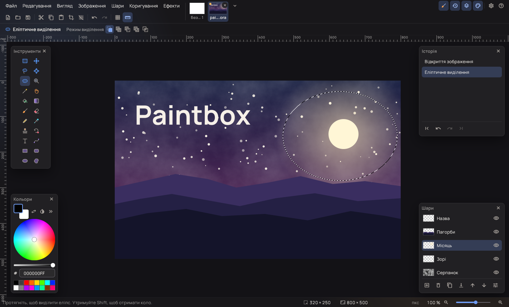
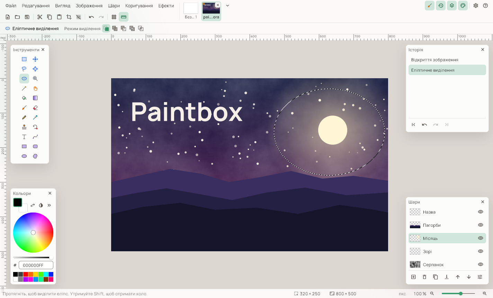
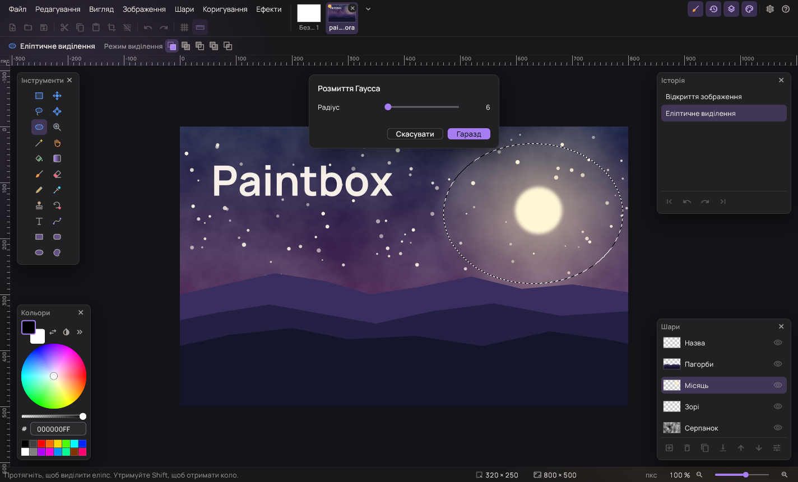

# Paintbox

[English](README.md) · **Українська**

Paintbox — вільний редактор зображень для повсякденного малювання й
обробки фотографій. Він працює так само, як Paint.NET 3.x: шари, звичні
інструменти й ті самі сполучення клавіш. Програма розрахована на
Windows, Linux і macOS.

> **Альфа-версія.** Paintbox на ранньому етапі: описані нижче можливості
> працюють, але справжнього вжитку ще майже не бачили, тож можливі
> недоробки й помилки; тримайте копії важливих зображень. Повідомлення
> про помилки та пропозиції приймаються на сторінці
> [Issues](../../issues).



## Можливості

- **Шари**: додавайте, дублюйте, об'єднуйте, змінюйте порядок
  перетягуванням, ховайте шари, задавайте кожному непрозорість і один із
  14 режимів змішування.
- **Інструменти виділення**: прямокутник, еліпс, ласо й чарівна паличка
  з режимами заміни, додавання, віднімання, перетину й виключного АБО;
  контур виділення можна переміщувати, а виділені пікселі — переміщувати,
  повертати й масштабувати.
- **Інструменти малювання**: пензель, олівець, гумка, заливка, градієнт
  п'яти видів, штамп, перефарбування, піпетка, текст, лінії й криві зі
  стрілками та штрихами, прямокутники, заокруглені прямокутники, еліпси
  й довільні фігури.
- **Коригування**: автоматичні рівні, чорно-біле, яскравість і контраст,
  криві, відтінок і насиченість, інверсія кольорів, рівні, постеризація
  й сепія; ті, що мають параметри, показують попередній перегляд.
- **31 ефект**: художні (ескіз тушшю, олійний живопис, олівцевий ескіз),
  розмиття (Гаусса, у русі, радіальне, поверхні, розфокусування,
  наближенням, фрагментація), спотворення (опуклість, вм'ятини, матове
  скло, пікселізація, полярна інверсія, відбиття плиток, скручування),
  шум (додавання шуму, медіана, зменшення шуму), фото (сяйво, усунення
  червоних очей, різкість, м'який портрет), візуалізація (хмари, фрактали
  Жюліа й Мандельброта) і стилізація (виявлення країв, тиснення, контур,
  рельєф).
- **Файли**: OpenRaster (`.ora`) зберігає шари; також підтримуються PNG,
  JPEG, BMP, TGA і WebP. Зображення відкриваються у вкладках із
  мініатюрами, файли можна перетягнути у вікно.
- **Звичні клавіші**: інструменти вибирають літерами, `[` і `]` змінюють
  ширину пензля, `X` міняє кольори місцями, утримуючи пробіл, можна
  прокручувати зображення, Ctrl+коліщатко змінює масштаб, F5–F8
  показують вікна; сполучення клавіш меню — як у Paint.NET.
- **Оформлення й мова**: темна чи світла тема, шість акцентних кольорів
  або власний, 25 мов інтерфейсу.





## Завантажити

Альфа-збірки публікуються на сторінці [Releases](../../releases).

| Платформа | Пакунок | Стан |
|---|---|---|
| Windows 10 і 11 (x64) | Переносний zip, MSIX, інсталятор | Альфа |
| Linux (x64) | AppImage | У роботі |
| macOS (Apple silicon та Intel) | Підписана програма в dmg | У роботі |

## Збирання з вихідного коду

Потрібні Flutter 3.47 і стабільний Rust. Ядро на Rust компілюється під
час збирання програми Flutter:

```
cd app
flutter pub get
flutter run -d windows
```

Перевірки, знімки й пакування для кожної платформи описано в
[docs/building.md](docs/building.md), будову коду — у
[CONTRIBUTING.md](CONTRIBUTING.md) (документація англійською).

## Ліцензія

Paintbox — вільне програмне забезпечення, що поширюється на умовах
[GNU General Public License версії 3 або новішої](LICENSE). Ним можна
користуватися, вивчати його, поширювати й змінювати; хто поширює змінену
версію, мусить відкрити її код на тих самих умовах. Ліцензії
перенесеного коду, шрифту й бібліотек наведено в [NOTICE.md](NOTICE.md)
і [docs/third-party.md](docs/third-party.md), а в самій програмі — у
«Довідка → Ліцензії».

## Подяка

Paintbox завдячує своїм задумом **Paint.NET**, чий випуск 3.36 був
відкритим на умовах ліцензії MIT, і **Pinta** — відкритому редакторові в
дусі Paint.NET. Багато режимів змішування, коригувань, ефектів і
поведінки інструментів Paintbox перенесено з їхнього коду. Paintbox —
незалежний проєкт, не пов'язаний із жодним із них; «Paint.NET» —
торговельна марка її власника.
